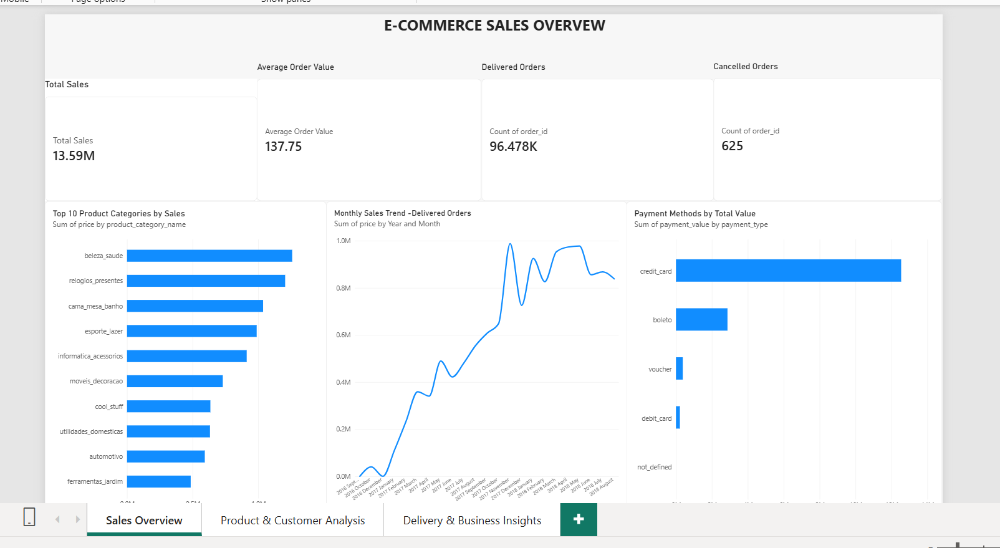
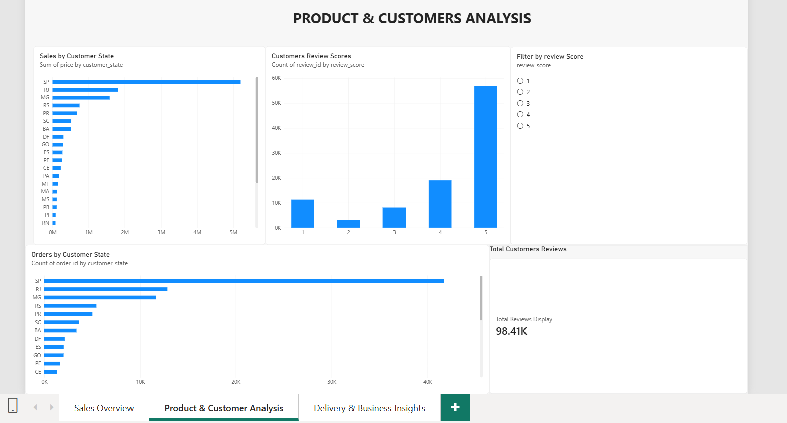
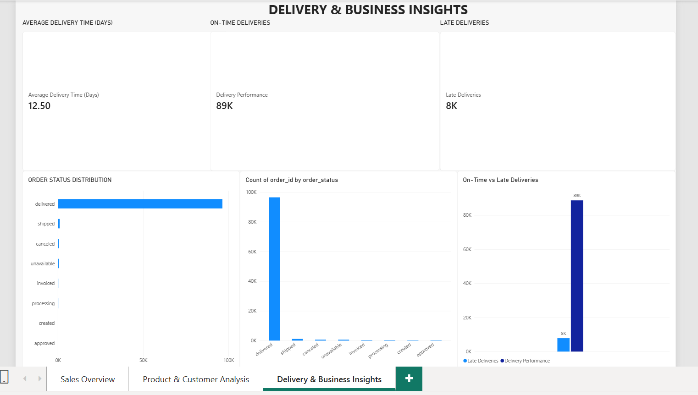

### E-Commerce Sales Analysis using MySQL and Power BI


### Project Overview


This project analyses e-commerce sales data to understand sales performance, customer behaviour, payment methods, customer reviews, and delivery performance.


The project uses MySQL for data storage and SQL analysis and Microsoft Power BI to build interactive dashboards that present business insights.

## Executive Summary

### Business Overview
This project analyzes Brazilian e-commerce data using MySQL and Microsoft Power BI to understand sales performance, customer satisfaction, product categories, payment methods, and delivery efficiency.

### Key Performance Indicators
- **Total Sales: R$13.59 million**
- **Total Orders: 99,441**
- **Delivered Orders:96,478**
- **Average Review Score: 4.09 out of 5**
- **Average Order Value:R$137.75**

### Business Objective
Transform e-commerce data into actionable insights to help businesses monitor sales, understand customer experiences, and improve operational decisions.


### Project Objectives


\- Analyse overall sales and average order value.

\- Identify top-performing product categories.

\- Examine monthly sales trends.

\- Analyse customer distribution across states.

\- Understand customer review scores.

\- Compare payment methods by total payment value.

\- Evaluate order statuses and delivery performance.

\- Present insights through interactive dashboards.


### Tools and Technologies


\- MySQL

\- SQL

\- Microsoft Power BI

\- DAX

\- Microsoft Excel / CSV files

\- GitHub


### Dataset


The project uses the Brazilian Olist e-commerce dataset.


The analysis uses seven tables:


1\. Customers

2\. Orders

3\. Order Items

4\. Payments

5\. Products

6\. Reviews

7\. Sellers


### Dashboards


\### 1. Sales Overview


This dashboard presents:

\- Total Sales

\- Average Order Value

\- Delivered Orders

\- Cancelled Orders

\- Top 10 Product Categories

\- Monthly Sales Trend

\- Payment Methods by Total Value


\### 2. Product and Customer Analysis


This dashboard presents:

\- Sales by Customer State

\- Orders by Customer State

\- Customer Review Scores

\- Total Reviews

\- Review Score Filter


\### 3. Delivery and Business Insights


This dashboard presents:

\- Average Delivery Time

\- On-Time Deliveries

\- Late Deliveries

\- Order Status Distribution

\- On-Time vs Late Deliveries


### Key Results


\- Total product sales: R$13,591,643.70

\- Average product sales per order containing items: R$137.75

\- Total orders: 99,441

\- Delivered orders: 96,478

\- Cancelled orders: 625

\- Total reviews: 98,410

\- Average customer review score: 4.09 out of 5

\- Average delivery time: approximately 12.50 days


### SQL Analysis


SQL was used to analyse:


\- Total sales and average order value

\- Order status distribution

\- Payment methods and payment values

\- Customer distribution by state

\- Product category performance

\- Customer review scores

\- Delivery performance


### Business Value


The analysis helps businesses understand sales performance, customer satisfaction, payment preferences, and delivery outcomes.


These insights can support decisions about product performance, customer experience, and delivery operations.


### Skills Demonstrated


\- SQL querying and aggregation

\- Relational database analysis

\- Data validation

\- DAX measures

\- Power BI dashboard development

\- Business data interpretation

\- Data visualisation


### Conclusion


This project demonstrates how SQL and Power BI can be used together to analyse e-commerce data and communicate business insights through interactive dashboards.


## Power BI Dashboard Screenshots

### 1. Sales Overview


### 2. Product and Customer Analysis


### 3. Delivery and Business Insights



## Power BI Report

Download or open the interactive Power BI report using the link below:

[Open E-Commerce Sales Analysis Power BI Report](https://drive.google.com/file/d/1P-mQaJmdDNJK6K7rwKgV7o4dtqoZK4Nu/view?usp=sharing)
## Project Repository

This repository contains the SQL queries, project report, and Power BI dashboard screenshots for the E-Commerce Sales Analysis project.


## Business Insights & Recommendations

### 1. Sales Performance
- **Finding:** Total sales reached R$13.59 million across 99,441 orders.
- **Recommendation:** Track monthly sales and order trends to identify periods of strong and weak performance.

### 2. Customer Satisfaction
- **Finding:** The average customer review score was 4.09 out of 5.
- **Recommendation:** Monitor low-rated reviews to identify recurring customer complaints and service improvements.

### 3. Delivery Performance
- **Finding:** 7,826 delivered orders were classified as late among orders with the required delivery dates.
- **Recommendation:** Investigate delivery delays by customer state and seller to identify where improvements may have the greatest impact.

### 4. Order Fulfilment
- **Finding:** 96,478 orders were delivered, while 625 were cancelled.
- **Recommendation:** Monitor cancellation patterns to identify potential fulfilment and customer-service issues.

### 5. Payment Methods
- **Finding:** Credit cards and boleto were important payment methods in the sales data.
- **Recommendation:** Compare payment methods by order count and sales value to understand customer preferences.

### 6. Product Performance
- **Finding:** Sales performance varied across product categories.
- **Recommendation:** Compare category revenue and order volume to identify products that may deserve additional business attention.


## Data Cleaning & Validation

Data quality checks were performed to understand the dataset and improve the reliability of the analysis.

### Validation Checks
- Checked the row counts of the imported database tables.
- Reviewed order statuses and delivery date availability.
- Checked review records and identified duplicate review IDs.
- Compared key sales and order metrics with SQL query results.
- Used SQL and Power BI to analyze and visualize the data.

### Data Quality Notes
- The dataset contains 99,441 customer records and 99,441 order records.
- The reviews table contains 98,410 unique review IDs.
- Eight delivered orders were missing one or more required delivery dates for delivery-performance calculations.
- Delivery-performance percentages were calculated using orders with the required delivery dates available.

### Tools Used
- MySQL: Data validation, SQL queries, and analysis.
- Power BI: Data visualization, KPI cards, and interactive dashboards.


## Project Structure

```text
ecommerce-sales-analysis/
├── ALL ANALYSIS.sql
├── ecommerce_sales_setup.sql
├── advanced_monthly_sales_growth.sql
├── advanced_top_product_categories.sql
├── advanced_repeat_customer_analysis.sql
├── advanced_top_seller_analysis.sql
├── sql_analysis/
│   └── README.md
├── Documentation/
│   ├── Ecommerce_Sales_Project_Report.docx
│   └── Ecommerce_Sales_Project_Report.pdf
├── 01_Sales_Overview.png
├── 02_Product_Customer_Analysis.png
├── 03_Delivery_Business_Insights.png
└── README.md


## SQL Skills Demonstrated

- **Joins:** Combined data from customers, orders, order items, and products.
- **Aggregations:** Used `SUM()`, `COUNT()`, and `GROUP BY` to summarize business metrics.
- **Common Table Expressions (CTEs):** Organized complex queries into readable steps.
- **Window Functions:** Used `LAG()` for month-over-month sales analysis and `DENSE_RANK()` to rank product categories and sellers.
- **Conditional Aggregation:** Calculated repeat-customer metrics using `CASE` expressions.
- **Data Validation:** Checked table row counts, review IDs, order statuses, and delivery-date availability.
